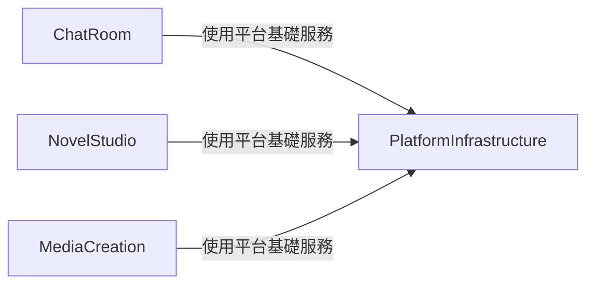

# AI platform 設計圖

## 1. 專案目標
- **做什麼**：開源、在本機運行的綜合 AI 應用平台，整合角色聊天、小說創作與多媒體生成。
- **為什麼做**：訂閱制對輕度使用者不划算，通用模型審查過嚴、AI 味重且品質不穩，現有平台功能分散、不是為角色扮演與創作設計，生圖工具學習曲線又太陡。
- **給誰用**：想用自己的 API key 或本地模型，自由使用 AI 做角色扮演、寫作與影音創作的個人使用者。

## 2. 範圍
### 要做
- 聊天：用角色卡建立角色，支援一對一與多角色群組聊天，具備全域、聊天室、角色三層記憶。
- 小說：結合記憶與設定集的寫作環境，可在不同步驟搭配不同模型撰寫與修編。
- 多媒體：簡單管理提示詞與姿勢、以對話輔助生圖，一鍵固定（訓練）角色，並用角色製作漫畫、影片與配音。
- 模型串接：語言模型支援 OpenAI、Gemini、Grok、Claude、OpenRouter 的 API；圖片支援本地 Forge 與 API；影片與聲音支援 API。
- 使用者自行輸入 API key、自行付費。
- 本地模型由使用者先自行啟動本地服務（例如 Forge）；未啟動或硬體跑不動時，提示使用者啟動服務或改用 API。

### 不做
- 帳號系統：目前只做單人使用，商業化時再加。
- 手機 App、角色卡分享市集、社群功能：先不做，但架構保留擴充空間。
- 內容過濾：平台不加內容限制，由使用者選擇的模型決定。
- 跨模組共用內容：聊天、小說、多媒體的角色與資料各自管理，不互相連動。

## 3. 設計理念
- **模組化與介面溝通**：核心模組與小模組都只透過介面溝通，不直接讀取彼此的資料（原因：問題能限縮在單一小模組內，新增模組也不影響既有模組）。
- **資料物件化**：資料以物件定義，統一經由資料存取層讀寫（原因：日後加帳號或換儲存方式只需改一處）。
- **本機單人優先，保留雲端擴充**：現在只做本機單人，但不把單人與本機寫死在模組裡（原因：保留商業化與上雲端的路）。
- **使用者自主**：平台不加內容限制，模型、供應商、本地或 API 都由使用者選擇（原因：擺脫通用平台的審查與限制是專案初衷）。
- **簡單好用**：把複雜流程（例如角色訓練）包裝成簡單操作（原因：現有工具學習曲線太陡是專案初衷之一）。
- **多語系架構**：介面文字集中管理、不寫死在畫面裡，目前只做繁體中文（原因：日後可切換語言）。

## 4. 技術選型
| 項目 | 選擇 | 原因 |
|---|---|---|
| 前端 | React + Vite（TypeScript） | 生態系完整，適合漫畫編輯等複雜介面 |
| 後端 | Node.js（TypeScript） | 與前端同語言可共用型別；本地 AI 工具由使用者自行啟動，後端透過其 API 或指令呼叫 |
| 後端框架 | Fastify | 內建 TypeScript 型別，有統一的錯誤攔截機制，plugin 機制方便各模組登記路由 |
| 前後端溝通 | HTTP + JSON；串流與即時推播用 SSE | 路徑可直接對應到模組與介面；SSE 由瀏覽器內建，log 即時顯示與 LLM 逐字串流共用同一套機制 |
| 資料存放 | SQLite（Node 內建的 `node:sqlite`），每個核心模組放在自己的 `data/<Module>/` | 單檔免安裝、適合本機，模組資料集中好備份，日後可換成雲端資料庫 |
| 測試 | Vitest | 與 Vite 同一套生態，前後端都能用 |
| 部署 | 本機運行，提供 `start.bat` / `start.sh` 啟動檔（需先安裝 Node.js 24 以上） | 開源專案下載後一鍵啟動，並支援本地模型；Node 24 以上才內建 `node:sqlite` |

所有模組都要遵守的專案規則（錯誤格式、log、資料存放、機密資訊、畫面共通規則）寫在 `docs/conventions.md` 第 9 段。

## 5. 核心模組
（依實作順序排列，被依賴的模組排在前面）

| 核心模組 | 負責什麼 | 有畫面 |
|---|---|---|
| PlatformInfrastructure | 平台基礎：啟動、模型串接、log 與錯誤、主題與語言、前端外殼與共用元件 | 是 |
| ChatRoom | 角色卡、一對一與群組聊天、三層記憶 | 是 |
| NovelStudio | 小說寫作、設定集、多模型撰寫與修編 | 是 |
| MediaCreation | 生圖、提示詞管理、角色固定、漫畫、影片與配音 | 是 |

## 6. 模組關係

- **ChatRoom、NovelStudio → PlatformInfrastructure**：呼叫語言模型、寫 log，使用資料庫工具、主題與語言、外殼與共用元件。
- **MediaCreation → PlatformInfrastructure**：呼叫語言、圖片、影片、聲音模型（含長時間任務）、寫 log，使用資料庫工具、主題與語言、外殼與共用元件。
- **分工原則**：所有呼叫 AI 模型或 AI 服務（雲端或本地）的事都經過 PlatformInfrastructure，它負責串接、傳送，並提供每個模型的能力；其他模組各自存參數模板、依能力決定要用哪些功能，拿回結果後自己處理。不是 AI 的處理（裁圖、排版、存檔等）由各模組自己做。

---

## 7. 待討論
- **啟動檔放置位置**：`start.bat` / `start.sh` 依放置規則不能放在根目錄，但使用者習慣在根目錄找啟動檔；專案功能完成後再決定位置並製作。
- **前端畫面怎麼提供**：開發時與正式執行時，前端畫面由誰提供、怎麼連到後端的 `/api`；目前的想法是開發時用 Vite 開發伺服器並轉送 `/api` 到後端，正式執行時由後端提供打包後的前端。實作 PlatformInfrastructure 的後端進入點前決定。
- **本地聲音工具**：要不要支援本地語音或歌聲工具（例如 GPT-SoVITS、RVC），討論 MediaCreation 時再決定。
- **音樂 / 歌唱類型**：要不要成為第五種模型類型，討論 MediaCreation 時再決定。
