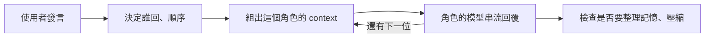
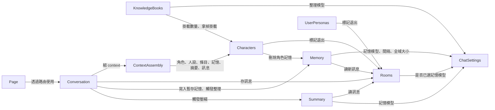

# ChatRoom spec

## 1. 做什麼
平台的聊天功能，也是打開平台後第一個看到的模組。使用者建立角色（自己選模型、參數、提示詞、記憶、知識書），再把角色和自己的人設放進聊天室聊天；一對一就是只有一個角色的聊天室。

核心想法：在主流 AI 網頁版聊天，本質上就是一種角色扮演。本模組把背後的模型、記憶、知識、搜尋拆開讓使用者自己組，讓每個角色有自己的個性，並隨著聊天累積記憶而成長；同時保有搜尋、思考等能力，也能當成提供正確資訊的日常聊天工具。

**不做**：
- 匯入、匯出角色卡，複製角色，把角色另存成模板。
- 聊天分支、刪除已送出的訊息、編輯角色的發言。
- 知識書的語意搜尋、角色自己翻知識書的工具。
- 「抽籤」發言方式、訊息上的「記住這則」按鈕。
- 和 NovelStudio、MediaCreation 共用角色或資料（依 design.md）。

## 2. 運作流程
1. 第一次使用：到聊天設定選「記憶模型」，沒選就不能建立聊天室。
2. 準備角色：可以先建角色模板；建角色時可以套用模板（複製值），也可以直接選模型；掛上事先建好的知識書。
3. 建立聊天室：加入角色和人設（各至少一個），決定開不開全域記憶。
4. 聊天：選用哪個人設發言 → 依發言方式決定哪些角色回、順序 → 每個角色輪到時，組出它自己的 context 送給它的模型，串流回覆。
5. 背景整理：新訊息累積到一定數量、閒置、或對話快放不下時，先整理記憶，必要時再把舊對話壓縮成摘要。

## 3. 規則

### 進入與提醒
- 打開平台時進入聊天室列表，最近聊過的排最上面，並自動打開最近聊過的聊天室。
- 平台裡還沒有任何 LLM 模型時，聊天的每一頁上方提示「還沒有可用的模型，請先到平台設定新增 API key 和模型」，並附前往平台設定的按鈕。

### 能力與上限的顯示（模板、角色卡共用）
- 模型能力標「支援」才出現可以調的欄位；「未知」寫「未知」、不能調，送出時用供應商預設；「不支援」反灰並寫原因。
- 依能力決定的功能也一樣：模型不支援工具，角色記憶就不能開，並寫出原因。
- 選模型時顯示模型的能力、context 上限、輸出上限（不知道就寫「未知」）。
- 輸出長度可以調時用拉條，範圍照平台給的上下限，不讓使用者自己填數字。

### 角色模板
- 內容：模板名稱、模型、參數、角色提示詞的各格（角色名稱除外）。
- 套用時把值**複製**到角色卡，之後兩邊互不影響；建角色時可以不套用模板。
- 模板不含知識書、角色記憶、頭像。
- 模板的模型失效（被刪除、key 被刪除）時，模板保留並標示「模型失效」。

### 角色卡
- 提示詞分格：角色名稱、描述（必填）；個性、說話方式、情境、對話範例、開場白（選填）。送出時依固定順序組成系統提示詞。
- 另有頭像（沒上傳用預設頭像）、模型、參數、掛載的知識書、角色記憶開關與大小、每次送出上限。
- **每次送出上限**：拉條，最大到模型上限，預設 128,000（模型上限比這個小時用模型上限）；模型上限未知時預設 32,000、可以調。旁邊提示「上限越大，每次回覆越貴」。
- **空間分配**：角色卡上用分顏色的橫條顯示提示詞、常駐知識、記憶、摘要、聊天原文、留給回覆各佔多少，以及剩下幾 %；固定的部分放不下時變紅。
- 刪除角色：它在的每個聊天室顯示「XXX 已退出聊天室」；以前的發言保留，名字畫刪除線並標「角色已刪除」、頭像改成預設；它的角色記憶一併刪除。

### 使用者人設
- 內容：名稱、頭像、描述（一格）。
- 一開始就有一個「使用者」人設，代表真人的你：**不能刪**，名稱和描述可以改。
- 人設和角色一樣用「加入」的方式進聊天室；一個聊天室可以有好幾個人設，發言時選用哪一個。
- 刪除人設的規則比照角色（標「人設已刪除」）。聊天室裡沒有人設時不能發言。

### 知識書
- 一本知識書有很多條目；條目有標題、內容、關鍵字，並選「常駐」或「關鍵字觸發」。
- 常駐條目每次都放進對話；觸發條目在最近的對話出現關鍵字時才放進去。
- 知識書用**關聯**的：掛在角色上，改了知識書，所有掛著它的角色下一次說話都用新內容。只掛在角色上，一個角色可以掛好幾本。
- 只有使用者能在知識書區塊編輯（打字、貼上，或交給 AI 整理），角色不能寫入。每本顯示大約多少 token。
- **AI 整理**：貼一段文字讓 AI 切成條目，或下指令修改；結果先預覽，按「套用」才放進編輯中的書，再按儲存。用聊天設定的「知識書整理模型」，沒選時提示並帶使用者去聊天設定。
- 刪除知識書前提示「有 N 個角色掛著這本書」，刪除後從那些角色身上拿掉。

### 聊天室
- 建立時填：名稱、加入的角色和人設（各至少一個）、全域記憶開關、聊天室情境（選填）、聊天室記憶大小、摘要大小。
- 建立後可以再加入或移出角色、人設；移出時聊天室顯示「XXX 已退出聊天室」，以前的發言保留。
- **全域記憶開關建立後不能改**；沒開就不讀也不寫全域記憶。
- 聊天設定沒選記憶模型時不能建立聊天室；記憶模型之後失效時，聊天室不能發言，提示「記憶模型失效，請到聊天設定重新選擇」。

### 發言
- **發言方式**（聊天室設定三選一）：
  - 自然（預設）：被 @ 的角色依點名順序先回；其他角色依「健談度」決定要不要開口；都沒人開口就隨機一個。
  - 輪流：照成員順序每人一次，順序可以拖曳調整。
  - 手動：使用者點誰誰說。
- 健談度設在聊天室的成員設定上（0～100%，預設 50%），同一個角色在不同聊天室可以不同。
- 任何方式都有「讓他說話」和「靜音」。
- 角色一個接一個說，後面的角色看得到前面角色剛說的話。
- **自動模式**：自動接著聊 N 輪（1～10，預設 3），聊完自動停，打字或按停止也會停。
- **停止**：正在說的那則留下已產生的部分並標「已中止」，後面排隊的取消。
- 切頁面、重新整理、關掉分頁都不會中斷，回來時接著顯示；關掉平台就停止，下次打開時沒說完的標「已中止」。

### 訊息
- 只能改**最後一則自己的訊息**，而且要在角色說完之前；改完重送時，被中止的半截回覆拿掉。只要有角色完整說完，就不能再改。
- 角色的發言不能改；任何已送出的訊息都不能刪。
- 只有**最後一則角色訊息**可以重新生成；舊版本保留，可以左右切換，對話以選中的版本為準。
- 可以上傳圖片、PDF、文字檔（文字檔讀成文字再送）。看不到的角色收到「（XXX 傳了一張圖片，你看不到內容）」；聊天室裡沒有任何角色看得到時，上傳按鈕反灰並寫原因。
- 思考內容放在回覆上方，預設收起；搜尋來源列在回覆下方，可以點開。
- 每則訊息顯示發言時間、token 和花費，有複製按鈕。
- 模型上限未知的角色被供應商拒絕時，額外提示「這個模型的上限未知，可能是每次送出上限設太大，請到角色卡調小」。

### 每次說話送出的內容（context）
- 依序是：角色提示詞、在場成員（其他角色的名字、人設的名字和描述）、現在時間、聊天室情境 → 知識書（常駐＋觸發的條目）→ 記憶（全域，有開才放；聊天室；角色）→ 對話摘要 → 最近的聊天原文 → 留給回覆的空間。
- 每個角色用自己的「每次送出上限」；扣掉固定的部分後，剩下的放聊天原文，越新的越優先。
- 固定的部分（含摘要）放不下時，這個角色不能發言，顯示「XXX 的模型放不下設定的記憶和知識書，請到角色卡調整」；不偷偷刪減記憶。
- token 數是依字數估算的，畫面上寫「約」；估算偏多一點，避免算少而超過上限。

### 對話壓縮
- 畫面上的原文永遠保留，壓縮只影響送給模型的版本。
- 一個聊天室一份摘要，所有角色共用；什麼時候壓縮，依聊天室裡聊天原文空間最小的角色決定，所以每個角色看到的都是「摘要＋接得上的原文」。
- 壓縮前一定先整理記憶。
- 摘要超過摘要大小（2,000～50,000，預設 8,000）時，重寫成更精簡的版本。
- 摘要可以在聊天室設定查看和修改。壓縮使用記憶模型。

### 記憶
- 三層：
  | 記憶 | 記什麼 | 誰看得到 | 誰寫 | 在哪裡編輯、設大小 |
  |---|---|---|---|---|
  | 全域 | 真人的你：喜好、習慣、生活狀況 | 有開全域記憶的聊天室裡所有角色 | 記憶模型，只從「使用者」人設的發言學習 | 聊天設定 |
  | 聊天室 | 這個聊天室的劇情、約定、變化 | 這個聊天室的所有角色 | 記憶模型 | 聊天室設定 |
  | 角色 | 角色自己的經歷和感受 | 只有這個角色，在每個聊天室都帶著 | 角色自己的模型，用工具寫 | 角色卡 |
- 記憶是一條一條的，每條有內容、重要度（1～5）、最後提到的時間、記在哪個聊天室。整份都放進對話，大小就是它佔用的空間（5,000～30,000，預設 10,000）。
- 角色有兩個工具：新增一條記憶、修改一條記憶。指示角色只記重要、長期有用的事。
- 角色寫的記憶先暫存，回覆定下來（後面有人說了新的話）才正式寫入；被重新生成捨掉的版本、被中止的回覆，暫存的記憶不寫入。
- 聊天室、全域記憶的整理時機：新訊息累積到 N 則（預設 20，可以在聊天設定調）、有新訊息但閒置 10 分鐘、壓縮前、使用者的訊息裡有「記住」「記下來」「加入……記憶」這類字時馬上整理。每次整理呼叫一次記憶模型，同時更新聊天室和全域記憶。使用者明確要求記的一定要記；沒開全域記憶卻要求加入時，提示這個聊天室沒有開全域記憶。
- 記憶更新時，聊天室顯示一行灰色小字（例如「聊天室記憶已更新（新增 1 條）」「XXX 記住了一件事」），點一下可以看是哪一條。
- 用到 90% 時整理：合併相近的條目 → 濃縮很久以前的細節 → 還是太多就刪掉重要度低、又很久沒提到的。刪掉的不留底。聊天室和全域記憶由記憶模型整理，角色記憶由角色自己的模型整理。
- 條目可以**鎖定**，鎖定的永遠不會被合併、濃縮或刪除。
- 三個編輯的地方都可以新增、修改、刪除條目，改重要度、鎖定。

### 聊天設定
- **記憶**：記憶模型（也負責對話壓縮）、全域記憶大小與條目、整理間隔。
- **知識書**：知識書整理模型。
- 模型從平台已儲存的 LLM 模型裡選；模型失效時標示「模型失效」。

## 4. 重要決定

### 一對一也是聊天室
- **決定**：一對一和群組是同一種聊天室，只差角色數量。
- **原因**：規則只有一套，一對一隨時可以再加角色變成群組。

### 模板用複製，知識書用關聯
- **決定**：套用模板是複製值；知識書是掛載關聯。
- **原因**：模板是「建角色時不用重調」的起點，改模板不應該讓一堆角色個性突然改變；知識書是共用的資料，改一次所有角色都要拿到新內容。
- **考慮過**：模板也用關聯、角色只保留微調的部分——改一處全部更新，但規則複雜、容易出乎意料。

### 上限設在角色上，不設在聊天室
- **決定**：每次送出上限設在角色卡；聊天室不設 context 上限。
- **原因**：上限代表角色「腦袋多大」，和記憶大小一樣屬於角色本身；大小模型可以在同一個聊天室各自發揮。
- **考慮過**：角色和聊天室都設、取比較小的——可以讓閒聊的聊天室省錢，但三層上限疊在一起，很難看懂角色為什麼看不到某段話。

### 一份摘要，依最小的角色壓縮
- **決定**：一個聊天室一份摘要，什麼時候壓縮依空間最小的角色決定；大模型拿摘要加更多原文（可以和摘要重疊）。
- **原因**：每個角色都不會出現中間沒人整理的斷層。
- **考慮過**：每個角色各自一份摘要——大模型能用滿空間，但每次壓縮要做好幾次，花費和等待都變多。

### 放不下就擋下，不偷偷刪
- **決定**：固定的部分放不下時，角色不能發言並提示調整。
- **原因**：自動砍短記憶會讓角色莫名其妙忘記事情，使用者也不知道原因。

### 角色記憶由角色自己寫，聊天室和全域記憶事後整理
- **決定**：角色記憶由角色的模型在聊天當下用工具寫；聊天室、全域記憶由記憶模型在背景定期整理。
- **原因**：角色記住什麼本身就是個性的一部分；記憶模型不在對話裡，適合像主流 AI 一樣事後整理，也不拖慢聊天。
- **代價**：角色寫記憶時那次回覆多一次呼叫。

### 全域記憶只從「使用者」人設學習
- **決定**：全域記憶只記「使用者」人設的發言，其他人設的發言不寫入。
- **原因**：其他人設是角色扮演的設定，不是真人的事；用人設分辨比讓模型猜更清楚。「使用者」人設不能刪，所以永遠存在。

### 不能刪訊息，只能改還沒被回完的最後一則
- **決定**：已送出的訊息不能刪；只能改最後一則自己的訊息，且在角色說完之前；只有最後一則角色訊息能重新生成。
- **原因**：前面的訊息一改，後面的回覆、摘要、記憶就對不上。保留「送錯了馬上停下來改」這個實際需要就夠。

### 記憶獨立成一個小模組
- **決定**：三層記憶都由 Memory 負責，記錄每條屬於誰；畫面上仍在角色卡、聊天室設定、聊天設定裡編輯。
- **原因**：三層的規則完全一樣，寫一次就好；角色忘了事情時直接找 Memory。
- **考慮過**：分散到 Characters、Rooms、ChatSettings 裡——比較直覺，但同一套規則要寫三次，記憶的問題也混在其他功能裡。

### token 用估算
- **決定**：空間分配、什麼時候壓縮，都由本模組依字數估算 token，估算時留一點餘裕。
- **原因**：平台不提供 token 計算，各家算法也不同；估算偏多比算少而被供應商拒絕好。

### 知識書用常駐＋關鍵字觸發
- **決定**：每個條目選常駐或關鍵字觸發。
- **原因**：不需要工具，任何模型都能用，又能省空間。
- **考慮過**：整本放進去（太佔空間）、角色自己用工具查（要模型支援工具且夠聰明）、語意搜尋（平台沒有這種模型，要多接一種服務）。

## 5. 小模組
（依實作順序，被依賴的排前面）

| 小模組 | 前端／後端 | 負責什麼 |
|---|---|---|
| ChatSettings | 後端 | 聊天全域設定 |
| CharacterTemplates | 後端 | 角色模板 |
| Rooms | 後端 | 聊天室、成員、聊天室設定、訊息紀錄與版本、附件 |
| Memory | 後端 | 三層記憶的存取、角色寫記憶的工具、定期整理、快滿整理 |
| Characters | 後端 | 角色卡、頭像、掛載的知識書、刪除角色的連動 |
| UserPersonas | 後端 | 使用者人設、刪除人設的連動 |
| KnowledgeBooks | 後端 | 知識書與條目、挑出要放入的條目、AI 整理 |
| Summary | 後端 | 對話壓縮：什麼時候壓縮、產生與精簡摘要 |
| ContextAssembly | 後端 | 組出每個角色要送出的內容、算空間分配 |
| Conversation | 後端 | 發言順序、自動模式、串流與背景持續、停止、重新生成、安排記憶整理和壓縮 |
| Page | 前端 | 所有畫面，見 page.md |

- **ContextAssembly** 讀取 Characters、UserPersonas、KnowledgeBooks、Memory、Summary、Rooms，圖上只畫一條。
- **Page** 透過本模組的路由使用所有後端小模組，圖上只畫一條。
- **Conversation** 是唯一呼叫 `streamModel` 的地方；記憶整理、壓縮、知識書 AI 整理用 `invokeModel`。
- **刪除的連動**由被刪的一方通知：Characters、UserPersonas 通知 Rooms 標記退出，Characters 通知 Memory 刪記憶，KnowledgeBooks 通知 Characters 拿掉掛載。
- **角色記憶的快滿整理**用角色自己的模型，由 Conversation 把模型交給 Memory，Memory 不讀 Characters，避免互相依賴。

## 6. 對外介面
| 介面 | 前端／後端 | 用途 | 輸入 → 輸出（大意） | 提供者 |
|---|---|---|---|---|
| registerRoutes | 後端 | 登記本模組所有 HTTP 路由（含串流的 SSE），由後端進入點以 `/api/ChatRoom` 為前綴登記 | 後端伺服器 | 各後端小模組 |
| getModuleRegistration | 前端 | 提供聊天的登記資訊，由前端進入點登記進外殼 | 無 → 登記資訊 | Page |

- 其他核心模組不使用本模組的資料（依 design.md）。

## 7. 使用的外部介面
| 介面 | 來源模組 | 用途 |
|---|---|---|
| openDatabase | PlatformInfrastructure | 開啟本模組的資料庫 |
| createError、isPlatformError、defineErrorCodes | PlatformInfrastructure | 錯誤物件與錯誤代碼 |
| writeLog | PlatformInfrastructure | 寫 log |
| listModels、getModelParams | PlatformInfrastructure | 查模型、能力、上限、可調參數 |
| streamModel | PlatformInfrastructure | 角色回覆（串流、可中止、工具） |
| invokeModel | PlatformInfrastructure | 記憶整理、對話壓縮、知識書 AI 整理 |
| registerTextTable、getText、getAssetUrl | PlatformInfrastructure | 文字表、預設頭像等素材 |
| useSharedComponents、showModal、showConfirm、showToast、showError | PlatformInfrastructure | 共用元件與視窗 |
| useLeaveGuard | PlatformInfrastructure | 未儲存離開確認 |

## 8. 資料
| 資料 | 存哪裡 | 負責的小模組 | 說明 |
|---|---|---|---|
| 聊天設定 | `data/ChatRoom/chat-room.db` | ChatSettings | 記憶模型、知識書整理模型、全域記憶大小、整理間隔 |
| 角色模板 | 同上 | CharacterTemplates | 模板名稱、模型、參數、提示詞各格 |
| 角色 | 同上 | Characters | 提示詞各格、模型、參數、記憶開關與大小、每次送出上限、掛載的知識書 |
| 頭像 | `data/ChatRoom/avatars/` | Characters、UserPersonas | 角色和人設的頭像圖片 |
| 人設 | `data/ChatRoom/chat-room.db` | UserPersonas | 名稱、描述、頭像；「使用者」人設標記為不能刪 |
| 知識書 | 同上 | KnowledgeBooks | 書名、條目（標題、內容、關鍵字、常駐或觸發） |
| 聊天室 | 同上 | Rooms | 名稱、情境、全域記憶開關、記憶與摘要大小、發言方式、自動模式輪數；成員（順序、健談度、靜音、退出或已刪除時的名字） |
| 訊息 | 同上 | Rooms | 發言者、內容與各版本、附件、思考內容、搜尋來源、供應商原始內容、token、花費、時間、是否中止 |
| 附件 | `data/ChatRoom/attachments/` | Rooms | 上傳的圖片、PDF、文字檔 |
| 記憶 | `data/ChatRoom/chat-room.db` | Memory | 屬於誰、內容、重要度、最後提到的時間、記在哪個聊天室、是否鎖定；暫存中的角色記憶 |
| 摘要 | 同上 | Summary | 每個聊天室一份，記錄摘要到哪一則訊息為止 |

- 結構依 conventions.md 第 9 段用版本升級。

## 9. 驗收條件

### ChatSettings
- [ ] 沒有設定時，記憶模型和知識書整理模型未選，全域記憶大小 10,000，整理間隔 20 則
- [ ] 選的模型被平台刪除或 key 被刪除時，標示「模型失效」

### CharacterTemplates
- [ ] 可以新增、列出、修改、刪除模板
- [ ] 改了模板，已經用它建立的角色不變
- [ ] 模板的模型失效時，模板保留並標示「模型失效」

### Memory
- [ ] 角色用工具新增、修改的記憶先暫存，後面有人說了新的話才正式寫入
- [ ] 被重新生成捨掉的版本、被中止的回覆，暫存的記憶不寫入
- [ ] 新訊息累積到整理間隔、閒置 10 分鐘、壓縮前，各會觸發一次聊天室與全域記憶的整理
- [ ] 使用者的訊息含「記住」這類字時，馬上整理
- [ ] 全域記憶只從「使用者」人設的發言寫入；沒開全域記憶的聊天室不讀也不寫
- [ ] 記憶用到 90% 時整理，整理後不超過大小上限；鎖定的條目不被合併、濃縮或刪除
- [ ] 記憶有寫入或修改時，聊天室出現更新提示
- [ ] 刪除角色時，它的角色記憶一併刪除

### Rooms
- [ ] 聊天設定沒選記憶模型時，不能建立聊天室
- [ ] 沒有角色或沒有人設時，不能建立聊天室
- [ ] 建立後不能修改全域記憶開關
- [ ] 建立後可以加入、移出角色和人設；移出後以前的發言保留
- [ ] 角色或人設退出時（被移出或被刪除），出現「XXX 已退出聊天室」
- [ ] 已送出的訊息不能刪除；角色的訊息不能編輯
- [ ] 最後一則自己的訊息在角色說完之前可以修改重送，重送時被中止的回覆拿掉；有角色說完後就不能改
- [ ] 只有最後一則角色訊息可以重新生成；舊版本保留，可以切換

### Characters
- [ ] 名稱或描述沒填時不能儲存
- [ ] 能力不是「支援」的功能不能開啟；模型不支援工具時不能開啟角色記憶
- [ ] 每次送出上限預設 128,000，模型上限比較小時用模型上限；模型上限未知時預設 32,000
- [ ] 刪除角色：每個它在的聊天室出現退出訊息，以前的發言保留並標示「角色已刪除」，頭像改成預設

### UserPersonas
- [ ] 一開始就有「使用者」人設；它不能刪，名稱和描述可以改
- [ ] 刪除人設：每個它在的聊天室出現退出訊息，以前的發言保留並標示「人設已刪除」
- [ ] 聊天室裡沒有人設時不能發言

### KnowledgeBooks
- [ ] 常駐條目每次都放入；觸發條目只在最近的對話出現關鍵字時放入
- [ ] 改了知識書，掛著它的角色下一次說話就用新內容
- [ ] AI 整理的結果只回傳預覽，不直接改知識書
- [ ] 沒選知識書整理模型時，使用 AI 整理會提示先到聊天設定選擇
- [ ] 刪除知識書時回報有幾個角色掛著；刪除後那些角色不再掛著它
- [ ] 每本知識書顯示大約的 token 數

### Summary
- [ ] 聊天原文放不下空間最小的角色時，把最舊的一段壓縮進摘要，原文不變
- [ ] 壓縮前先整理記憶
- [ ] 摘要超過摘要大小時，重寫後不超過上限
- [ ] 修改後的摘要，下一次說話就用修改後的內容

### ContextAssembly
- [ ] 送出的內容依規定的順序組成，包含在場成員和現在時間
- [ ] 每個角色依自己的每次送出上限放入聊天原文，越新的越優先，不超過上限
- [ ] 每個角色看到的都是「摘要＋接得上的原文」，中間沒有斷層
- [ ] 固定的部分放不下時，角色不能發言並回報原因
- [ ] 看不到圖片或 PDF 的角色，收到提示文字而不是檔案
- [ ] 空間分配的各部分加總等於每次送出上限

### Conversation
- [ ] 自然：被 @ 的角色依點名順序先回；沒人開口時隨機一個；健談度 0% 的角色只在被 @ 時開口
- [ ] 輪流照成員順序；手動只在點名時說；靜音的角色不自動說話，「讓他說話」仍然有效
- [ ] 同一輪中，後面的角色看得到前面角色剛說的話
- [ ] 自動模式聊完設定的輪數就停；使用者打字或按停止也會停
- [ ] 按停止時，正在說的標「已中止」並保留已產生的部分，排隊的取消
- [ ] 前端斷線（切頁面、重新整理）時回覆照常完成，重新連上後看得到
- [ ] 平台重新啟動後，沒說完的訊息標「已中止」
- [ ] 記憶模型失效時不能發言，並提示重新選擇
- [ ] 模型上限未知的角色被供應商拒絕時，額外提示調小每次送出上限
- [ ] 角色用工具寫記憶後，回覆會接著完成
- [ ] 每則訊息記錄 token、花費和時間
- [ ] 實際建一個群組聊天室（兩個不同模型的角色），聊到觸發壓縮，角色仍然記得前面的重要事情（手動）
- [ ] 角色記憶開著聊一段時間，換到另一個聊天室，角色記得之前發生的事（手動）

### Page
- 見 page.md 的驗收條件。

---

## 10. 待討論
（目前無）
