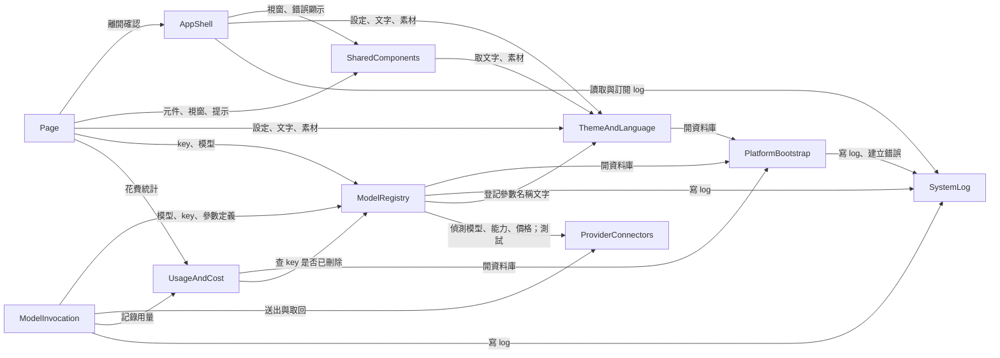

# PlatformInfrastructure spec

## 1. 做什麼
平台的基礎，也是第一個實作的核心模組。負責平台啟動與共用資料庫工具、系統 log 與錯誤處理、主題與語言、模型串接（API key、模型、呼叫、用量與花費），以及前端外殼與共用元件。

ChatRoom、NovelStudio、MediaCreation 都透過它的介面呼叫模型、寫 log、使用外殼與共用元件，彼此不直接讀取對方的資料。

**核心分工**：所有呼叫 AI 模型或 AI 服務（雲端或本地）的事都經過本模組。本模組負責串接與傳送，並把每個模型的能力準備好給其他模組查詢；其他模組存自己的參數模板，需要時把內容交給本模組，拿回結果後怎麼處理由它們自己決定。

**不做**：
- 各模組自己的選模型、調參數、存模板畫面：由各模組用共用元件自己組。
- 沒有可用 API key 時的提醒：由 ChatRoom 負責。
- 生成結果的保存：交給呼叫端存到自己的資料夾。

## 2. 運作流程
1. 使用者執行啟動檔，後端啟動並完成初始化，前端打開後進入 ChatRoom（ChatRoom 還沒做出來前，進入「平台設定」）。
2. 使用者到「平台設定 → API 串接」，選供應商、輸入 API key 與名稱後儲存。
3. 使用者依類型新增模型：選供應商 → 選已儲存的 key（Forge 改填位址）→ 系統偵測可用模型並列出能力 → 選模型 → 按測試確認可以呼叫 → 儲存，系統記下這個模型的可調參數。
4. 其他模組從已儲存的模型中挑選，依模型的能力決定要用哪些功能、調整參數，存進自己的模板；需要時透過本模組的介面呼叫模型。
5. 每次呼叫都記錄用量與花費並寫入系統 log；使用者可以在「花費統計」看統計，也可以展開畫面底部的 log 列查看過程。

## 3. 規則

### API key
- 一組 key = 供應商、名稱、key 值。同一家供應商可以存多組，用名稱區分，同供應商不能同名。
- 名稱和 key 值可以修改，供應商不能改（要換供應商就新增一組）。修改 key 時留空代表不變。
- 前端只顯示遮罩值：長度 12 以上顯示前 3 碼 + `****` + 後 4 碼，未滿 12 只顯示 `****`。
- **刪除 key 時不刪除模型**：只把選用這組 key 的模型的 key 欄位清空，模型要重新選 key 才能使用；被清空的模型被呼叫時回報錯誤。刪除前的確認視窗列出受影響的模型數量。
- 用量紀錄記在各個 key 底下；key 刪除後紀錄保留並標示「已刪除」，使用者可以手動刪除這些紀錄。

### 模型
- 類型：LLM、圖片、影片、語音。
- 各供應商提供的類型：OpenAI、Gemini、Claude 只有 LLM；Grok、OpenRouter 有 LLM、圖片、影片、語音；本地 Forge 只有圖片（不需要 key，填位址）。
- 要先選 key 才能偵測模型。同一類型下可選的模型，以供應商回傳的清單為準。
- 同一個模型可以用不同 key 新增多次，各自是一筆。
- 測試成功後才能儲存；之後改了供應商、key、位址或模型要重新測試，改名稱或價格不用。
- **測試不花錢**：LLM 送一則「Hi」（回覆上限 16 token），語音送「測試」兩個字；圖片、影片只確認 key 有效、模型存在，不實際生成。
- 刪除模型時提醒「其他模組正在使用的設定會失效」；本模組不讀其他模組的資料，所以不知道誰在用。之後呼叫被刪除的模型會收到錯誤，由該模組提示使用者重新選擇。

### 模型能力
- LLM 記錄七項能力：傳圖片、傳檔案、網頁搜尋、思考、調用工具、context window 上限、輸出上限。
- 每項標成「支援」「不支援」「未知」其中一種（context window 上限、輸出上限是數字或「未知」），以供應商回傳的資料為準，沒有提供的一律標「未知」，不自己猜。
- 新增模型時就把七項能力清楚列出，「未知」要明顯標示；能力跟著模型存下來，其他模組查模型時一併取得。
- **能力是給其他模組看的資訊，本模組不依能力擋下呼叫**：其他模組看到「不支援」就不使用那項功能；用了而供應商拒絕時，依本專案錯誤格式回報。
- 傳檔案目前支援 PDF；其他文字檔由呼叫端自己讀成文字再送。

### 可調參數
- LLM 依供應商決定列出哪些參數：
  - OpenRouter：列出 API 回報的所有可調參數。
  - Grok：溫度、回應長度。
  - Claude：回應長度（官方已移除溫度參數）。
  - Gemini：回應長度（新模型不再支援溫度等參數）。
  - OpenAI：沒有共通的可調參數。
  - 所有供應商：支援思考的模型，可調參數多一個「思考程度」；網頁搜尋不是「不支援」的模型，可調參數多一個「網頁搜尋」。這兩個參數開不開、調多少，由呼叫端每次決定，本模組只照著送出。
- 圖片、影片、語音的參數（尺寸、比例、張數、秒數、聲音等）依各家官方文件由平台內建；能即時查詢的選項（OpenRouter 的可選值、Grok 的聲音清單、Forge 的模型檔、LoRA、取樣器）向 API 即時查詢。
- 圖片可以附參考圖改圖（Grok、OpenRouter、Forge）、影片可以附一張圖當第一個畫面；Forge 的 LoRA 可以選多個，各自調權重。
- 其他模組使用時只顯示可調的參數；沒有可調參數時提示使用者。
- 參數超出範圍或選項不在清單中時回報錯誤；不在定義中的參數略過不送；沒填的參數有預設值用預設值，沒有就交給供應商決定。

### 呼叫
- 本模組只負責傳送與接收：把呼叫端給的內容轉成各家的格式送出，再把回應轉回統一的格式交給呼叫端，不替呼叫端處理結果。
- LLM 的對話中，每一則可以附上圖片、PDF。
- **工具由呼叫端執行**：呼叫時可以附上工具清單；模型要求使用工具時，本模組不執行，只把「哪個工具、帶什麼內容」回傳給呼叫端；呼叫端執行完再呼叫一次，把結果送回模型。
- 回應中的回覆文字、思考內容、工具請求、網頁搜尋的來源分開交給呼叫端，要不要顯示、怎麼使用由呼叫端決定。
- 回應另外附上「供應商原始內容」（思考簽章、加密推理內容等）：呼叫端不用看懂，跟著那則回覆存起來，下一輪原樣送回，多輪對話和工具來回才能正常接續；換了供應商或模型時本模組自動略過。
- LLM 支援串流，回覆逐字顯示；呼叫端可以中止串流，中止時不記錄用量。
- 失敗時依本專案錯誤格式回報，例如 key 無效、額度不足、本地服務沒有啟動。**不自動重試**。
- 已經拿到生成結果、但記錄用量失敗時，照常回傳結果（不讓已花的錢白費），log 註明記錄失敗。

### 長時間任務
- 耗時的生成（影片、圖片、語音）用任務處理：後端負責送出、追蹤進度、取回結果。使用者切換頁面或關閉瀏覽器分頁，任務都會繼續。
- **任務只存在平台執行期間**：關閉平台時，進行中的任務和還沒取走的結果都會消失。結果被呼叫端取走一次後就移除。
- 供應商有提供百分比時顯示進度條，沒有時顯示等待動畫和狀態文字（排隊中、處理中）。
- 同一個 Forge 位址一次只執行一個任務，其他的排隊。
- 影片任務超過 30 分鐘還沒完成，視為失敗。

### 本地服務
- 本地服務由使用者自行啟動，平台只負責連線、測試，以及沒連上時提示「請先啟動 Forge（需加上 --api）或改用 API」。目前只有圖片的 Forge。

### 用量與花費
- 花費 = 用量 × 模型儲存的價格；沒填價格的模型只統計用量。
- **花費是估算值**，實際金額以各供應商的帳單為準；花費統計畫面要標示這只是估算。
- 計費單位：LLM 以 token（輸入、輸出分開計價）加上網頁搜尋次數，圖片以張，影片以秒，語音以輸入字數。依音檔秒數計價的語音模型用字數算不準，價格可以留空。
- 網頁搜尋的手續費不在 token 裡，按「搜尋次數 × 每次搜尋價格」另外算；沒填每次搜尋價格時只統計次數。OpenRouter 直接用它回報的搜尋金額。
- 工具每來回一次算一次呼叫，各自記錄用量。
- 新增模型時，抓得到價格的（OpenRouter、Grok 的 LLM）自動帶入，抓不到的由使用者填或留空；價格不能是負數。
- 花費在記錄當下計算並存起來，之後改模型價格不影響舊紀錄。
- 本地 Forge 不花錢，不列入花費統計，只寫 log。
- 統計依每小時（最近 24 小時）、每天（最近 30 天）、每週（最近 12 週，週一開始）、每月（最近 12 個月）查看，以電腦的當地時間分格；沒有用量的格子也要顯示。

### 系統 log
- 依 conventions.md 第 9 段的 log 原則。
- 平常只顯示最新一筆，點一下展開成完整列表，可以依等級（正確、警告、錯誤）篩選。
- 每筆記錄：時間、等級、模組、做了什麼、結果（狀態、耗時、用量、key 名稱）；出錯時附上錯誤代碼的白話說明，點開可以看訊息和細節。
- 出錯時完整記下供應商回傳的錯誤內容。
- 存在 `data/PlatformInfrastructure/` 的紀錄檔：單檔上限 10MB，寫滿就換新檔，只保留最近 2 個檔（最多約 20MB）。畫面最多保留最近 1000 筆。
- 寫 log 不會讓呼叫它的功能失敗：寫檔失敗時只在終端機顯示錯誤，畫面上的 log 照常保留。

### 錯誤處理
- 前端和後端各有一個最外層的錯誤攔截，接住意外錯誤後寫 log、顯示錯誤提示，不讓整個平台當掉。
- 前端某個頁面畫面出錯時，只有內容區顯示錯誤畫面，navbar 和 log 列照常；切換到其他頁面後恢復。

### 啟動與資料庫
- 後端、前端進入點只負責組裝（登記各模組），初始化邏輯由本模組負責。新增核心模組時只需要在這兩處登記。
- 啟動時建立 `data/`；各模組的資料夾和資料庫在**第一次使用時**才建立、開啟並自動升級結構；任何資料被讀取之前，資料庫一定已經升級完成。
- 某個模組的資料庫開啟或升級失敗時，只影響那個模組，錯誤寫進 log 並回報給使用者。
- 資料庫的版本比程式新時（例如用舊版平台開新版資料），不修改任何資料，提示使用者更新平台。
- 某一版升級失敗時，退回那一版，資料維持在升級前的狀態。

### 外殼、主題與語言
- 上方 navbar 切換核心模組，側邊欄切換子頁面（子頁面 2 個以上才顯示），畫面最下方是 log 列。
- 本模組在 navbar 上叫「平台設定」，放在最右邊，和功能模組分開。子頁面：基礎設定、API 串接、花費統計。
- 網址對應到模組和子頁面，重新整理後停在同一頁；網址不存在時導回首頁。
- 主題包含顏色、字體等視覺設定和畫面素材；各模組只用素材名稱引用，換主題時素材跟著換。目前只有 default 主題：日式動漫風格、清晰乾淨的淺色系，配色與素材完整，像精心設計過的成品。
- 主題載入失敗時改用 default，畫面照常顯示。
- 主題、語言存在本模組的資料庫，其他模組透過介面查詢。設定變更後重新整理頁面才生效。
- 找不到文字時顯示文字鍵本身，並寫一筆警告（同一個鍵只寫一次）。

## 4. 重要決定

### 所有 AI 呼叫都經過本模組
- **決定**：凡是呼叫 AI 模型或 AI 服務（對話、生圖、影片、語音，之後的訓練等）都由本模組串接；不是 AI 的處理（裁圖、排版、存檔、管理角色卡等）由各模組自己做。
- **原因**：規則只有一套；key 不離開本模組；各家的差異只處理一次，某一家改了 API 只要修一個地方；用量與花費不會漏記。
- **考慮過**：
  - 各模組自己串接，本模組只存 key、模型、價格——LLM 至少三個模組要用，同樣的串接要寫三次。
  - 通用的呼叫走本模組、專門的功能（例如 Forge 訓練）由模組自己串接——規則變成兩套，key 也要交給其他模組。
- **代價**：其他模組要用新的 AI 功能時，要先在本模組加上對應的參數或任務類型。

### 工具由呼叫端執行
- **決定**：本模組只傳送工具清單、模型的工具請求和工具結果，不執行工具。
- **原因**：工具通常會動到呼叫端自己的資料（例如寫入記憶），怎麼處理是呼叫端的事。
- **考慮過**：呼叫端交出工具的執行方法，由本模組自動來回到結束——本模組要管來回次數上限與中途出錯，一次對話的多次呼叫也難以分開記錄 log 和用量。

### 能力只提供資訊，不擋呼叫
- **決定**：模型能力給其他模組判斷要不要用某項功能，本模組不依能力擋下呼叫。
- **原因**：有些供應商不提供能力資料（標為「未知」），擋下會讓這些模型什麼功能都用不了；由呼叫端依能力決定，出錯時由供應商的錯誤回報。

### 資料庫在第一次使用時才開啟
- **決定**：各模組的資料庫在第一次使用時開啟並升級，不在啟動時一次處理。
- **原因**：一個模組的資料庫壞掉時，只影響那個模組。
- **考慮過**：啟動時就開啟並升級所有資料庫——問題能在啟動時發現，但要決定整個平台停止還是跳過，容易拖累其他模組。

### 提供共用的資料庫工具
- **決定**：本模組提供開啟、讀寫、升級 SQLite 的共用工具；共用的是「操作方法」，不是「資料」，每個模組只開自己的資料庫檔。
- **原因**：避免各模組各寫一套，寫法不一致、出錯要修好幾次。

### OpenAI、Gemini 只提供 LLM
- **決定**：LLM 以外的類型改由 Grok、OpenRouter 提供。
- **原因**：OpenAI 的影片 API 已關閉、語音模型即將關閉；Gemini 的串接方式和其他家不同；兩家的模型清單也沒有標示類型，串接成本高。

### 非 LLM 的參數由平台內建
- **決定**：圖片、影片、語音的參數依官方文件內建，可選項目向 API 即時查詢。
- **考慮過**：只用 API 回報的參數——非 LLM 模型幾乎都會變成沒有參數可調，無法使用。

### 刪除 key 只清空模型的 key 欄位
- **考慮過**：一併刪除選用它的模型——模型設定要整個重建，不如清空 key 欄位讓使用者重新選。

### 任務不存檔
- **考慮過**：任務與結果存檔，平台重新啟動後繼續追蹤——增加複雜度；要拿結果就不要在等待期間關閉平台。

### 不做共用的模型選擇器
- **決定**：只提供基本元件和查詢模型、參數的介面，由各模組自己組選模型的畫面。
- **原因**：三個模組選模型後的用法和儲存方式都不同。

## 5. 小模組
（依實作順序，被依賴的排前面）

| 小模組 | 前端／後端 | 負責什麼 |
|---|---|---|
| SystemLog | 前後端 | 系統 log 的寫入、存檔、查詢與即時推送；錯誤物件的定義；後端最外層錯誤攔截 |
| PlatformBootstrap | 後端 | 平台啟動初始化；開啟、讀寫、自動升級 SQLite 的共用資料庫工具 |
| ThemeAndLanguage | 前後端 | 主題與語言設定的儲存與查詢、文字表的集中管理（含錯誤代碼的白話說明）、依目前主題取得素材位址 |
| ProviderConnectors | 後端 | 各供應商與 Forge 的串接，一家一個檔案：把平台的統一格式轉成各家的格式送出，再把回應（文字、思考內容、工具請求、搜尋來源、用量、錯誤）轉回統一格式 |
| ModelRegistry | 前後端 | API key、模型的新增與管理、偵測、測試、模型能力、可調參數定義 |
| UsageAndCost | 前後端 | 用量紀錄、花費計算（含網頁搜尋）、花費統計 |
| ModelInvocation | 後端 | 模型呼叫：檢查參數、串流與中止、長時間任務的排隊與追蹤、呼叫完記錄用量 |
| SharedComponents | 前端 | 共用元件：基本元件、視窗類、回饋類（含任務進度顯示） |
| AppShell | 前端 | 外殼：navbar、側邊欄、log 列、套用主題、前端最外層錯誤攔截、模組登記與頁面切換、未儲存離開確認 |
| Page | 前端 | 「平台設定」的子頁面：基礎設定、API 串接、花費統計，見 page.md |

- 所有小模組出錯時都透過 SystemLog 建立錯誤物件、寫 log。
- ProviderConnectors 是唯一知道各家格式的地方；某一家改了 API，只改那一家的檔案。它不寫 log，錯誤包進錯誤物件往上丟。
- Page 提供「平台設定」的登記資訊（`getModuleRegistration`），由前端進入點呼叫 AppShell 的 `registerModule` 登記；Page 自己不登記。

## 6. 對外介面
（其他核心模組可以呼叫的。精確型別在 `src/shared/PlatformInfrastructure/types`）

| 介面 | 前端／後端 | 用途 | 輸入 → 輸出（大意） | 提供者 |
|---|---|---|---|---|
| initializePlatform | 後端 | 後端啟動時初始化平台，由後端進入點呼叫 | 無 | PlatformBootstrap |
| registerRoutes | 後端 | 登記本模組所有 HTTP 路由，由後端進入點以 `/api/PlatformInfrastructure` 為前綴登記 | 後端伺服器 | SystemLog、ThemeAndLanguage、ModelRegistry、UsageAndCost |
| handleUnexpectedError | 後端 | 掛上後端最外層錯誤攔截，由後端進入點呼叫 | 後端伺服器 | SystemLog |
| openDatabase | 後端 | 開啟模組自己的資料庫檔，不存在時建立，並自動升級結構 | 模組、檔名、各版本的升級內容 → 讀寫方法 | PlatformBootstrap |
| createError | 前後端 | 建立錯誤物件 | 模組、介面、代碼、訊息、細節 → 錯誤物件 | SystemLog |
| isPlatformError | 前後端 | 判斷某個值是不是錯誤物件 | 任意值 → 是／否 | SystemLog |
| defineErrorCodes | 前後端 | 登記模組自己的錯誤代碼和等級（警告或錯誤）；同一個代碼重複登記時啟動就報錯 | 代碼與等級 → 代碼 | SystemLog |
| writeLog | 前後端 | 寫入一筆系統 log | 一筆 log | SystemLog |
| getSettings | 前後端 | 查詢主題、語言 | 無 → 設定 | ThemeAndLanguage |
| registerTextTable | 前端 | 登記模組自己的文字表 | 文字表 | ThemeAndLanguage |
| getText | 前端 | 依目前語言取得文字 | 文字鍵、參數 → 文字 | ThemeAndLanguage |
| getAssetUrl | 前端 | 依目前主題取得素材位址 | 模組、素材名稱 → 位址 | ThemeAndLanguage |
| listModels | 前後端 | 查詢已儲存的模型，可依類型篩選 | 類型 → 模型清單（含能力） | ModelRegistry |
| getModelParams | 前後端 | 查詢某個模型的可調參數 | 模型 → 參數定義 | ModelRegistry |
| invokeModel | 後端 | 呼叫模型並取得完整結果 | 模型、參數、輸入（LLM 為對話，可附圖片、PDF、工具清單、工具結果；之前的回覆帶上它的供應商原始內容）→ 結果（回覆文字、思考內容、工具請求、搜尋來源、供應商原始內容）、用量、花費 | ModelInvocation |
| streamModel | 後端 | 串流呼叫 LLM，可中止 | 模型、參數、對話（同上）→ 逐段的回覆文字與思考內容，最後一段帶工具請求、搜尋來源、供應商原始內容、用量 | ModelInvocation |
| submitTask | 後端 | 送出長時間生成任務 | 模型、參數、輸入（圖片可附參考圖、影片可附第一個畫面的圖）→ 任務 | ModelInvocation |
| getTask | 後端 | 查詢任務的狀態、進度與結果（完成後只能取一次） | 任務 ID → 任務 | ModelInvocation |
| useSharedComponents | 前端 | 使用共用元件 | 無 → 元件集合 | SharedComponents |
| showModal | 前端 | 顯示彈出視窗，可以在關閉前先確認 | 標題、內容 | SharedComponents |
| showConfirm | 前端 | 顯示確認視窗 | 標題、說明、按鈕文字 → 是否確認 | SharedComponents |
| closeAllModals | 前端 | 不經確認關閉所有視窗，由外殼在換頁後呼叫 | 無 | SharedComponents |
| showToast | 前端 | 顯示提示訊息 | 類型、文字 | SharedComponents |
| showError | 前端 | 顯示錯誤訊息，標明哪個模組、哪裡出錯 | 錯誤物件 | SharedComponents |
| registerModule | 前端 | 把模組的 navbar 資訊和頁面掛進外殼，由前端進入點呼叫 | 名稱、路由、子頁面 | AppShell |
| startAppShell | 前端 | 載入設定、套用主題並畫出外殼，由前端進入點在登記完模組後呼叫 | 無 | AppShell |
| useLeaveGuard | 前端 | 有未儲存的修改時，離開前跳出確認 | 是否有未儲存的修改 | AppShell |
| getModuleRegistration | 前端 | 提供「平台設定」的登記資訊，由前端進入點登記進外殼 | 無 → 登記資訊 | Page |

- 設定頁使用的 key、模型、用量介面（新增、修改、刪除、偵測、測試等）只給本模組的 Page 用，不列在這裡。
- `invokeModel`、`streamModel`、`submitTask`、`getTask` 只給其他模組的後端使用；各模組的前端透過自己模組的路由取得結果。

## 7. 使用的外部介面
無。

## 8. 資料
| 資料 | 存哪裡 | 負責的小模組 | 說明 |
|---|---|---|---|
| 平台設定 | `data/PlatformInfrastructure/platform-infrastructure.db` | ThemeAndLanguage | 主題（預設 `default`）、語言（預設 `zh-TW`） |
| API key | 同上 | ModelRegistry | 供應商、名稱、key 值（不加密） |
| 模型 | 同上 | ModelRegistry | 類型、供應商、模型名稱、顯示名稱、選用的 key（key 刪除後為空）或 Forge 位址、價格（LLM 含每次搜尋價格）、能力、可調參數定義 |
| 用量紀錄 | 同上 | UsageAndCost | 每次呼叫一筆：key（刪除後保留）與當時的 key 名稱、模型、用量（含搜尋次數）、花費、時間 |
| 系統 log | `data/PlatformInfrastructure/system.log`、`system.1.log` | SystemLog | 一行一筆；10MB 換檔，只留 2 個檔 |
| 長時間任務 | 只在記憶體 | ModelInvocation | 平台關閉就消失 |

- 同一個資料庫檔由 ThemeAndLanguage、ModelRegistry、UsageAndCost 共用，結構版本各自記錄。

## 9. 驗收條件

- 六家供應商都依官方文件串接，自動測試用官方文件的請求與回應範例。真實 key 的手動驗收只做 OpenRouter、Grok 和本地 Forge；OpenAI、Gemini、Claude 只有自動測試，README 註明尚未用真實 key 驗證。

### SystemLog
- [ ] 寫入的 log 查得到，新的在前，可以依等級篩選
- [ ] 紀錄檔超過 10MB 時換新檔，最多只留 2 個檔
- [ ] 平台重新啟動後，能從紀錄檔讀回最近的 log；損壞的行會被略過
- [ ] 寫檔失敗時，寫 log 的功能不會失敗，畫面上的 log 仍查得到
- [ ] 後端回傳錯誤時，同一個錯誤只寫一筆 log；回應不含程式堆疊
- [ ] 後端發生未預期的錯誤時，寫進 log，平台不會停止

### PlatformBootstrap
- [ ] 啟動時建立 `data/`，重複啟動不出錯
- [ ] 新資料庫從第 1 版升到最新版；舊資料庫只執行還沒執行過的版本
- [ ] 某一版升級失敗時退回那一版，之前的版本保留
- [ ] 資料庫版本比程式新時，資料不被修改並回報錯誤
- [ ] 錯誤細節中不含 SQL 參數（參數可能有 key）
- [ ] 自動測試不碰正式的 `data/`

### ThemeAndLanguage
- [ ] 沒有設定時，主題為 default、語言為繁體中文
- [ ] 儲存不存在的主題或語言時回報錯誤，資料不被修改
- [ ] 可選的主題只列出含有 theme.css 的主題資料夾
- [ ] 找不到文字時顯示文字鍵，同一個鍵只寫一筆警告
- [ ] 素材位址依目前主題組出

### ProviderConnectors
- [ ] 各家的對話、圖片、PDF、工具清單、工具結果、思考程度、網頁搜尋開關，正確轉成該家的格式
- [ ] 各家回應中的回覆文字、思考內容、工具請求、搜尋來源、用量（含搜尋次數）正確取出，轉成統一格式
- [ ] 圖片、影片、語音的參數、參考圖、第一個畫面、LoRA 正確轉成各家格式；結果、進度、用量（張數、秒數、字數）正確取出
- [ ] 供應商的各種錯誤（key 無效、額度不足、太頻繁、拒絕、服務錯誤、連不上）對應到正確的錯誤代碼

### ModelRegistry
- [ ] 新增、列出、修改、刪除 API key；列出時只有遮罩值；只改名稱時 key 不變
- [ ] 同供應商同名的 key 無法新增
- [ ] API key 不出現在任何回應、log 與錯誤細節中
- [ ] 刪除 key 後，選用它的模型 key 欄位變空，呼叫時回報錯誤；重新選 key 後可以正常呼叫
- [ ] 替模型選了不同供應商的 key 時回報錯誤
- [ ] 各供應商的模型清單、自動帶入的價格、可調參數正確產生
- [ ] 七項能力依供應商回傳的資料標成支援、不支援或未知；供應商沒提供的一律標未知
- [ ] 能力跟著模型存下，`listModels` 查得到
- [ ] 支援思考的模型，可調參數有「思考程度」；網頁搜尋不是「不支援」的模型，可調參數有「網頁搜尋」
- [ ] 偵測、測試各剛好一筆 log
- [ ] OpenRouter、Grok 用真的 key 新增一個 LLM 模型並測試成功，七項能力的顯示和官方文件相符（手動）
- [ ] Grok 自動帶入的 LLM 價格和官網價格頁相同（手動）
- [ ] OpenRouter 或 Grok 用無效的 key 測試時，顯示 key 無效（手動）

### UsageAndCost
- [ ] 花費計算正確；沒填價格只統計用量；Forge 不記錄用量
- [ ] 搜尋花費為搜尋次數 × 每次搜尋價格；沒填每次搜尋價格時只統計次數；OpenRouter 用它回報的搜尋金額
- [ ] 統計的格數為 24、30、12、12，已刪除的 key 標示「已刪除」；只能刪除已刪除 key 的用量紀錄

### ModelInvocation
- [ ] 串流逐段送出回覆文字與思考內容，最後一段帶用量；呼叫端中止時不記錄用量
- [ ] 參數超出範圍或選項不在清單中時回報錯誤；不在定義中的參數略過
- [ ] 本模組不依能力擋下呼叫；供應商拒絕時依錯誤格式回報
- [ ] 模型要求使用工具時，本模組不執行，回傳工具名稱和內容；呼叫端送回工具結果後，模型能接著回覆
- [ ] 開啟網頁搜尋時，回傳搜尋來源
- [ ] 任務依序從排隊到完成；完成後只能取一次；同一個 Forge 一次只跑一個；影片超過 30 分鐘標為失敗
- [ ] 每件事剛好一筆 log：一次呼叫、一次串流、一個任務各一筆；工具每來回一次各一筆；排隊和查進度期間沒有 log
- [ ] 已取得結果但記錄用量失敗時，結果照常回傳，log 為錯誤並註明
- [ ] （ChatRoom 串接後）OpenRouter、Grok 的 LLM：傳圖片、傳 PDF、調用工具、網頁搜尋、思考各試一次，結果都拿得到，花費統計出現用量（手動）
- [ ] （ChatRoom 串接後）Gemini 兩輪對話，回覆有接續上文（手動）
- [ ] （MediaCreation 串接後）Grok、OpenRouter 各生成圖片、短影片、語音都拿得到檔案，影片等待中有進度；改圖、讓圖動各試一次（手動）
- [ ] （MediaCreation 串接後）Forge 選模型檔、LoRA 生成圖片，有進度、拿得到圖片；改圖試一次（手動）

### SharedComponents、AppShell、Page
- 見 page.md 的驗收條件。

---

## 10. 待討論
- **MediaCreation 需要的 AI 功能**：訓練角色、ControlNet、姿勢等，討論 MediaCreation 時再把需要的任務類型和參數補進本模組。
- **Forge 要另外啟動**：使用者要自己先開 Forge 有點麻煩，之後再看怎麼處理。
